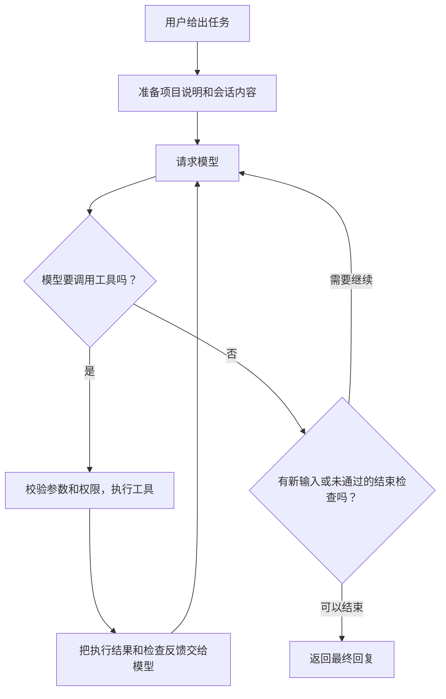

# mini-harness

一个小而完整的命令行编码助手。你给它一个任务，比如“修复失败的测试”，它可以阅读代码、修改文件、运行命令，再根据实际结果继续处理。

模型负责判断下一步做什么，mini-harness 负责把文件、终端、检查、会话记录和记忆接起来。这一层让模型能够在项目里持续工作的程序，就是这里所说的 **harness**。

项目使用 TypeScript 和 Node ≥ 24，零运行时依赖，支持 Linux、macOS、WSL 和原生 Windows。模型接口支持 Anthropic Messages 和 **OpenAI Responses（`/v1/responses`）**；OpenAI 适配器只使用 Responses。

主要功能：

- **读代码、改代码、跑命令**：通过 read、write、edit、bash 四个工具完成工作，执行过程实时显示。
- **根据检查结果继续修复**：可以在编辑后或任务结束前运行检查，把失败信息交给模型处理。
- **保存工作进度**：会话保存到本机，可以续接；长对话会清理旧输出或生成摘要。
- **积累项目记忆**：用普通 Markdown 保存经验，也可以通过 dream 从历史会话中整理笔记。
- **评测修改是否有效**：在独立目录中运行任务，比较不同提示词的通过率、用量和工具错误。

## 安装与运行

先准备 Node ≥ 24 和 pnpm；评测及 dream 还需要 Git。从项目根目录执行以下命令；Windows 使用 PowerShell 7，WSL 使用 Ubuntu bash。依赖应在实际开发所用的平台安装。

```sh
pnpm install
pnpm check
node dist/cli/main.js --help
```

开发时用 `pnpm dev`，构建后用 `node dist/cli/main.js`。下文的 `mh` 表示该构建入口；也可以自行执行 `pnpm link --global` 安装命令行链接。

Windows 下按 **Git Bash → PowerShell 7 → Windows PowerShell 5.1** 的顺序选择可用的命令环境，找到可用的一项就使用。模型会收到所选环境及语法说明。每次命令调用都启动独立进程，不保留上一次调用中的 `cd` 或临时变量；Windows 调用结束后也不会保留后台进程。超时和中断会清理相关子进程，具体机制见下文。

## 模型与环境变量

OpenAI Responses，Windows PowerShell：

```powershell
$env:OPENAI_API_KEY = '<YOUR_API_KEY>'
$env:OPENAI_BASE_URL = 'https://your-endpoint.example'
node dist/cli/main.js -p '检查项目并修复失败的测试' --provider openai --model gpt-6.1-sol
```

WSL Ubuntu：

```sh
export OPENAI_API_KEY='<YOUR_API_KEY>'
export OPENAI_BASE_URL='https://your-endpoint.example'
node dist/cli/main.js -p '检查项目并修复失败的测试' --provider openai --model gpt-6.1-sol
```

base URL 可以是站点根路径、以 `/v1` 结尾的路径，或完整的 `/v1/responses` 地址；客户端按需补齐路径。请求使用 `store: false`，由客户端保存和回传会话内容。

Anthropic 使用 `--provider anthropic --model <model-id>`。鉴权依次取模型的 `apiKeyEnv`、`ANTHROPIC_API_KEY`、`ANTHROPIC_AUTH_TOKEN`；最后一种发送 Bearer token。`ANTHROPIC_BASE_URL` 可覆盖默认地址。

密钥只放环境变量。配置中出现 `apiKey`、`token` 等字段会报错，错误信息不回显字段值。模型价格未知时显示 `n/a`；上下文默认 128000、输出默认 8192 是保守回退，实际窗口、价格和 thinking 能力应按所用端点的说明配置。

## 常用命令

```sh
mh                                  # 交互模式
mh -p '修复测试'                      # 只输出最终回复
mh -p '解释项目' --json               # 每行输出一个事件，方便其他程序读取
mh -c                               # 续接最近会话
mh -r <session-id> '继续'             # 续接指定会话
mh sessions                         # 列出当前项目的会话
mh trace latest --json               # 查看最近会话的执行记录
mh ralph '修复测试' --check 'node --test' --max-iter 5
```

可选 `--provider`、`--model`、`--thinking off|low|medium|high`、`--prompts <dir>`、`--max-turns N`、`--cwd <dir>`。打印模式退出码：0 完成、1 错误/轮次预算耗尽、2 参数错误、130 中断。

交互支持 `"""` 分隔的多行输入、运行中排队输入、Ctrl+C 中断、空闲时双按 Ctrl+C 退出。命令包括 `/help /model /compact /clear /cost /session /memory /exit`。工具输出与编辑 diff 追加显示，非 TTY 或 `NO_COLOR` 时无 ANSI 转义。

## 配置与权限

合并顺序：默认 → `~/.mh/config.json` → 项目 `.mh/config.json` → CLI 参数。`MH_HOME` 可覆盖数据目录。未知字段会报错并给出路径。

例如 `.mh/config.json`：

```json
{
  "provider": "openai",
  "model": "gpt-6.1-sol",
  "models": {
    "gpt-6.1-sol": {
      "provider": "openai",
      "apiKeyEnv": "OPENAI_API_KEY",
      "supportsThinking": true
    }
  },
  "thinking": "off",
  "hooks": {
    "afterEdit": [{ "match": "**/*.{ts,js}", "command": "node --check \"$MH_FILE\"", "timeoutSec": 30 }],
    "onStop": [{ "command": "node --test", "timeoutSec": 120 }],
    "maxStopContinuations": 2
  }
}
```

这里的 hooks 是“在指定时机自动执行的检查”：`afterEdit` 在匹配的文件被写入或编辑后运行，`onStop` 在模型准备结束任务时运行。它们默认都为空，需要按项目配置。

上述 hook 命令使用 bash 语法。PowerShell 回退时使用 `$env:MH_FILE`，例如 `node --check $env:MH_FILE`。文件路径通过环境变量传递，不插入命令文本。检查命令在项目根目录运行；`MH_FILE` 是本次修改文件的绝对路径。

项目 hooks 首次使用需要信任确认；配置改变后重新确认。无人值守默认忽略未信任的项目 hooks 并警告，`--trust-project` 显式信任当前配置。全局 hooks 可信。

默认允许读文件、工作区/会话/项目记忆中的普通写入；工作区外写入与匹配危险模式的命令需确认。交互中可选择仅本次允许、当前会话允许或拒绝；无人可问时拒绝。`--yolo` 跳过这类确认，dream/analyze 的写入范围仍受限制。

写入路径会先解析真实位置，避免通过符号链接或 Windows junction 绕过目录检查。命令检查覆盖部分删除、Git 历史改写、远程脚本和系统操作，也支持添加自定义模式。

权限层是防误操作的护栏，**不是安全边界**。命令模式检查可以被绕过；无人值守执行不可信内容应使用容器或操作系统隔离。

## 一个任务是怎样完成的

以“修复失败的测试”为例，模型可以先运行测试，读取报错涉及的源码，再修改文件并重新验证。每次工具执行的结果都会回到对话中，成为下一步判断的依据。



核心循环只负责“请求模型 → 执行工具 → 回传结果”。文件读写、权限、压缩、保存记录和终端显示由其他模块接入，因此可以单独测试循环，也可以替换模型接口或提示词。

一次回复里有多个工具调用时，按顺序执行。未知工具、参数错误、文件操作失败、权限拒绝都会变成模型能看到的工具结果，方便它修正下一次调用。输出达到长度限制时，会提示模型接着回答；用户在运行中输入的新要求会排队，在当前工具批次结束后加入，最终回复期间收到的输入也会继续处理。

一次“轮次”指一次主循环中的模型调用。交互模式默认不设轮数上限，打印模式默认 50 轮，评测任务默认 30 轮；可用 `--max-turns` 调整支持该参数的运行模式。

### 为什么只提供四个工具

四个工具分别覆盖阅读、创建、修改和执行。搜索文件、查看 Git 状态、运行测试等工作交给 shell 和项目已有命令，保持接口简单。

| 工具    | 用途                     | 关键行为                                                                                                                            |
| ------- | ------------------------ | ----------------------------------------------------------------------------------------------------------------------------------- |
| `read`  | 阅读文本或图片           | 文本带行号，支持 `offset`/`limit` 分段读取；单次最多 2000 行，过长行会截断；支持不超过 5MB 的 PNG/JPEG/GIF/WebP，模型也需要支持图片 |
| `write` | 创建或覆盖文件           | 自动创建父目录，返回写入字节数以及是否新建                                                                                          |
| `edit`  | 修改已有文件中的一段文字 | 精确匹配；多处匹配时要求补充上下文或显式 `replaceAll`，保留原有换行格式和编码标记，并显示修改差异                                   |
| `bash`  | 运行命令、搜索、测试     | 每次启动独立 shell，关闭标准输入；默认超时 120 秒，最多 600 秒；返回输出和退出状态                                                  |

工具描述保存在 `prompts/tools/`，与执行代码分开。错误也尽量给出可操作的提示：例如 edit 找不到目标时，会提示重新读取文件、检查空白，或移除从 read 输出复制来的行号。

### 修改后如何验证

有两种自动反馈，适合不同的任务长度：

| 方式                         | 什么时候检查                 | 失败后怎么继续                                         | 停止条件                                                                      |
| ---------------------------- | ---------------------------- | ------------------------------------------------------ | ----------------------------------------------------------------------------- |
| `afterEdit` / `onStop` hooks | 改完文件后，或模型准备结束时 | 把检查输出交回当前会话                                 | `onStop` 默认最多要求继续修复 2 次；预算耗尽后记录并显示仍失败的检查          |
| `mh ralph --check ...`       | 每次 agent 运行结束后        | 新建会话，带上原始任务、进度文件路径和上次检查输出尾部 | 检查通过、达到迭代上限、连续两次失败结果相同（忽略时间戳等变化），或中断/错误 |

例如，语法检查适合放在 `afterEdit`，项目测试适合放在 `onStop`。需要多次重新开始、靠进度文件接续的大任务，可以用 Ralph。Ralph 默认最多 5 次迭代，每次默认最多 50 轮，进度写在会话目录中的 `ralph-progress.md`。

检查反馈能帮助模型发现问题，但有次数预算。**普通运行显示“完成”不等于所有检查最终通过**；需要明确的通过条件时，应检查实际测试结果，或使用 Ralph / eval 的结果。

### 对话太长时怎么处理

测试日志和反复读取的源码会占用模型的上下文。mini-harness 用三种方式控制内容长度，让近期工作尽量留在模型眼前：

| 机制                   | 触发时机（默认值）                           | 处理方式                                                      |
| ---------------------- | -------------------------------------------- | ------------------------------------------------------------- |
| 长输出转存             | 单次工具结果超过 30000 字符或 2000 行        | 保存到会话的 `offload/`，回传头尾和文件路径，模型可以按需读取 |
| 清理旧结果（clearing） | 估算用量达到上下文窗口的 60%，但低于 80%     | 把较早、超过 1000 字符的工具结果换成简短占位，保留近期内容    |
| 生成摘要（compaction） | 估算用量达到窗口的 80%，或请求发生上下文溢出 | 用模型总结较早对话，再接上近期消息继续工作                    |

这些值可通过 `toolOutput` 和 `compaction` 配置调整。达到摘要阈值时直接生成摘要；摘要失败则保留当前对话。实际请求发生上下文溢出时，会尝试强制压缩，并在得到替换内容后重试一次。

摘要尽量从用户消息边界切分；连续工具调用时保留完整的调用与结果批次，避免留下无法配对的消息。原始记录保留在 `session.jsonl`，摘要也附带原记录路径。这里的 token 估算用于决定何时压缩，用量和费用仍以 API 返回数据及配置价格计算。

长输出转存保存的是工具返回的文本。shell 进程还有独立的内存保护：收集输出超过约 1000 万字符时会丢弃部分中段并给出标记，因此超大日志需要在命令里重定向到文件，才能完整保留。

### 关掉终端后如何继续

会话使用 JSONL 保存，即一行一个 JSON 记录。消息、压缩记录、模型切换以及工具和检查的执行信息都追加到同一个 `session.jsonl` 中；调试信息不会作为普通对话发送给模型。

运行 `mh -c` 或 `mh -r <session-id>` 时，会从最近的摘要和后续消息重建对话，并恢复上次使用的 provider/model；显式命令行参数优先。如果之前在工具执行中退出，会补上一条“未完成”的工具结果，让模型决定是否重试。如果只是文件最后一行因写入中断而不完整，会警告并保留前面的有效记录；中间记录损坏则报告行号。

这恢复的是工作记录和上下文，不能恢复已结束的 shell 进程。模型仍需检查磁盘上的当前状态，再继续操作。

## 项目记忆

项目记忆用来保存跨会话有用的信息，比如测试入口、容易踩到的坑、已经确认的项目约定。它由普通 Markdown 文件组成，可以直接阅读和编辑。

每个项目的数据位于 `MH_HOME/projects/<slug>/`，默认 `MH_HOME` 为 `~/.mh`。项目标识由 Git 根目录路径和短 hash 生成；非 Git 项目使用当前目录。

```text
~/.mh/
├── config.json
└── projects/<slug>/
    ├── sessions/<session-id>/
    │   ├── session.jsonl     # 对话与执行记录
    │   └── offload/          # 转存的长工具结果
    └── memory/
        ├── MEMORY.md         # 每次会话可见的简短索引
        ├── ...               # 按需读取的笔记
        └── .git/             # dream 使用的独立历史
```

只把 `MEMORY.md` 的前 200 行或 25KB（先到者为准）放入模型上下文；详细笔记按需通过 read 读取。模型使用普通 write/edit 更新记忆，不需要额外的“记忆工具”。

```sh
mh memory path
mh memory show
mh dream --sessions 10 --dry-run
mh dream --sessions 10
mh memory undo
```

Dream 是一次专门整理记忆的运行：默认读取最近 10 个会话，把值得保留的信息写进笔记、更新索引。输入会话先转换成可读的 Markdown，输入文件和已有笔记的路径明确提供给模型。

Dream 只有 read/write/edit 工具，写入只允许记忆目录，不能修改其中的 `.git`。运行前保存已有修改，运行后提交整理结果并显示变更统计；这些历史位于记忆自己的 Git 仓库，与代码仓库分开。`--dry-run` 在副本中执行。`memory undo` 显示变更统计、经交互确认后，用 Git revert 撤销最新的一次 dream；记忆目录有未提交修改时拒绝撤销。Git 不可用时普通记忆仍可用，dream 拒绝执行。

这是一套“历史会话 → 笔记 → 索引 → 下次按需读取”的工作方式，不涉及模型训练或向量数据库。笔记是否正确仍需要按实际项目情况核对。

## 评测与改进

修改提示词后，不能只看回复是否流畅，还要看任务有没有完成。项目自带 8 个纯 Node 种子任务：5 个 dev 用于分析和调整，3 个 heldout 留作独立检验。

每次尝试使用独立工作区、home 和会话，先保存代码的 Git 初始快照，再运行 agent，最后执行任务定义的检查命令。**检查退出码为 0 且没有超时或中断才算通过**；配置了模型评分（judge）的任务，还需要评分通过。模型评分依据任务要求、代码 diff、最终回复和评分标准，返回分数、是否通过及理由。

结果保存为 `results.jsonl`、`run.json`、`summary.md`，同时保留提示词快照、工作区和会话记录。可以追查一次失败到底是修改不正确、准备环境失败，还是 harness 本身出错。

```sh
mh eval run --provider openai --model gpt-6.1-sol --split all --repeat 2 --concurrency 2
mh analyze <run> --provider openai --model gpt-6.1-sol
mh eval run --provider openai --model gpt-6.1-sol --variant <variant-dir> --split all --repeat 2 --concurrency 2
mh eval compare <baseline-run> <candidate-run>
```

`--tasks 'fix-*'` 按任务 ID 筛选；`--output <dir>` 指定新结果目录。已有 `results.jsonl` 的目录不会被覆盖。评测命令全通过退出 0，存在失败退出 1；结果仍完整落盘。

完整流程是：**运行基线 → 分析 dev 失败 → 生成提示词候选 → 用相同任务和模型再跑 → 分别比较 dev/heldout**。

Analyze 只输入 dev 失败结果、对应会话记录和提示词副本，不输入 heldout。它只提供 read/write/edit，写入限于临时分析目录，最后产出独立变体和 `analysis.md`。默认 prompts 不会被替换；是否采用候选由使用者决定。没有 dev 失败时，直接复制原提示词并报告无需修改，不调用模型。

比较报告分别展示 dev/heldout 的通过率、平均 token、轮数与工具错误。重复运行可以观察波动；这 8 个小任务主要用于开发回归，不代表通用编码能力。基线与候选相同时，也不能把重复通过解释为优化收益。

## 源码设计

代码按职责分层，应用层负责把它们接起来。这样修改终端显示时不必碰模型协议，增加检查时也不必改核心循环。

| 层级 | 目录                                                      | 职责                                            |
| ---- | --------------------------------------------------------- | ----------------------------------------------- |
| 0    | `src/util/`                                               | 路径、进程、截断、模板等基础能力                |
| 1    | `src/ai/`                                                 | 模型接口、流式解析、用量与错误处理              |
| 2    | `src/agent/`、`src/session/`                              | agent 循环；会话保存与恢复                      |
| 3    | `src/tools/`、`src/context/`、`src/memory/`、`src/hooks/` | 工具、上下文、记忆和检查，各自独立              |
| 4    | `src/app/`                                                | 组装运行配置，提供普通任务、Ralph、dream 等入口 |
| 5    | `src/eval/`                                               | 任务运行、评分、失败分析和比较                  |
| 6    | `src/cli/`                                                | 参数、交互和终端输出                            |

模块只能依赖更低层或同目录文件，同层的不同目录不能相互引用。`agent/` 和 `ai/` 不直接操作文件、子进程或终端；`ai/` 通过 fetch 请求模型。只有 `cli/` 输出到终端。`cwd` 和 `home` 显式传递，禁止 `process.chdir`，让多个评测任务可以并发运行而不互相改变目录和数据位置。这些约束由 `scripts/check-layers.ts` 自动检查。

### 模型接口如何接入

内部使用统一的消息、工具调用、流式事件和用量结构，由两个适配器转换为具体协议。通过原生 fetch 和 SSE 解析器处理流式响应，不依赖模型 SDK。

| 适配器    | 请求方式                                                                                | 保留的信息                                                                     |
| --------- | --------------------------------------------------------------------------------------- | ------------------------------------------------------------------------------ |
| OpenAI    | `/v1/responses`，使用 `instructions`、`input`、function tools 和 `function_call_output` | 保存原生 output items，在后续请求中回传工具调用及加密推理；设置 `store: false` |
| Anthropic | `/v1/messages`，使用 content blocks 和 `tool_result`                                    | 合并连续工具结果，保留 thinking/signature，设置提示缓存标记                    |

流式解析处理 UTF-8 跨块、不同换行和多行 SSE data。网络/API 错误转换为统一错误结果；中断保留已收到的部分。429、部分服务端错误和网络错误只在尚未收到 SSE 事件时自动重试，最多 3 次，并遵守有上限的退避与 `Retry-After`；已经收到事件后不自动重发请求。

### 发送给模型的项目背景

系统提示按以下顺序组装：

1. `prompts/system.md`：基本工作方式。
2. 全局 `MH_HOME/AGENTS.md`，以及 Git 根目录到当前目录沿途的项目 `AGENTS.md`；项目目录缺失该文件时回退到 `CLAUDE.md`。
3. 项目记忆索引及笔记位置。
4. 当前目录、系统、日期、shell 和 Git 分支。

这些内容在同一个会话对象中保持稳定，减少每轮重复变化的背景；日期只精确到天。新会话和重新启动后的续接会重新组装，所以更新项目说明或记忆后，需要新的会话实例才能刷新这部分内容。提示词是独立文件，可用 `--prompts <dir>` 指定副本进行试验。

### Windows 与中断处理

Windows 优先寻找 Git for Windows 自带的 bash，不把 WSL 的 bash 启动器当成 Git Bash；找不到时先查找 PowerShell 7（程序名为 `pwsh.exe`），再回退到系统自带的 Windows PowerShell 5.1（程序名为 `powershell.exe`）。两者属于不同版本的 PowerShell，可以同时安装。工具名仍为 `bash`，实际描述会改为当前 shell 的语法。

Windows 用系统自带 PowerShell/.NET 创建 Job Object，把 shell 及后代纳入同一组，关闭 job 时结束组内进程；超时或 Ctrl+C 会通过 `taskkill` 终止运行器。运行器使用隐藏窗口，不修改 PowerShell 执行策略，所需脚本随构建复制。Linux/macOS/WSL 使用进程组，先发送 SIGTERM，再在必要时发送 SIGKILL。

中断信号从运行入口传到模型请求、工具和检查。已记录但未执行完成的工具调用会补上错误结果，避免续接时留下缺失配对的调用。

## 开发与验证

```sh
pnpm check
node scripts/test-inventory.ts --verify
node scripts/validate-tasks.ts
```

`pnpm check` 依次检查类型、分层、格式、离线测试和构建。离线测试使用临时 `MH_HOME`，默认禁止远程网络。测试基线保存在 `test/test-baseline.json`，inventory 用于发现已通过的测试被删除或跳过；任务验证脚本分别检查种子任务的原始状态和参考修复后的状态。

真实模型测试可使用 StepFun `step-5-preview`。PowerShell 配置如下（密钥自行填入环境变量）：

```powershell
$env:ANTHROPIC_AUTH_TOKEN = '<YOUR_API_KEY>'
$env:ANTHROPIC_BASE_URL = 'https://api.stepfun.com/step_plan/v1/messages'
$env:MH_LIVE = '1'
$env:MH_LIVE_PROVIDER = 'anthropic'
$env:MH_LIVE_MODEL = 'step-5-preview'
pnpm test:live
```

WSL 使用同名环境变量的 `export` 写法。可通过 `MH_LIVE_PROVIDER=openai`、`MH_LIVE_MODEL=<id>` 和 OpenAI 环境变量切换到 Responses 验收。不设置 `MH_LIVE` 时明确显示 skip。完整改进流程可执行 `node scripts/live-improvement.ts`，它运行两组 8×2 尝试并保存比较结果。

## 设计取舍

- **保持小而可读**：四个工具配合项目已有命令，零运行时第三方依赖，便于追踪一次任务的完整执行过程。
- **用文件保存状态**：会话、长输出、记忆和提示词都能直接查看，方便定位问题和比较修改。
- **让检查提供反馈**：把测试和命令结果交给模型继续处理；是否通过由实际检查判断。
- **给自动运行设置边界**：权限确认、超时、轮数和迭代次数控制误操作与无效循环；需要更强的执行隔离时由操作系统或容器提供。

v1 暂不包含 MCP、全屏 TUI、原生子 agent 工具、后台任务服务或会话分支。

## 参考资料与借鉴

以下资料帮助形成了本项目的设计。每项说明借鉴的思路及其在 mini-harness 中的对应实现；本项目采用自己的简化实现，能力范围以本文和代码为准。

| 资料                                                                                                                                                                                                                                   | 借鉴点与对应实现                                                                             |
| -------------------------------------------------------------------------------------------------------------------------------------------------------------------------------------------------------------------------------------- | -------------------------------------------------------------------------------------------- |
| [How to code Claude Code in ~200 lines of code](https://www.youtube.com/watch?v=s7ZzkdvCMDY) · [The Modern Software Developer 课程](https://www.themodernsoftware.dev/)                                                                | 从最小循环出发：模型决定工具调用，程序执行后把结果回传，再继续下一轮                         |
| Mario Zechner：[Pi coding agent 设计复盘](https://mariozechner.at/posts/2025-11-30-pi-coding-agent/)                                                                                                                                   | 克制工具数量、分离模型接口与循环、保持内核简单；对应四工具和可替换的模型/提示词              |
| OpenAI：[Harness engineering](https://openai.com/index/harness-engineering/)                                                                                                                                                           | 用仓库说明提供背景，把架构要求变成可执行检查；对应项目指令收集、分层检查和验证反馈           |
| Anthropic：[Writing effective tools for AI agents](https://www.anthropic.com/engineering/writing-tools-for-agents)                                                                                                                     | 工具名称、描述、参数和错误信息都服务于模型正确使用；对应工具契约、参数校验和可修正的错误提示 |
| Anthropic：[Effective context engineering for AI agents](https://www.anthropic.com/engineering/effective-context-engineering-for-ai-agents)                                                                                            | 只保留当前需要的信息；对应按需读取、旧结果清理、摘要和结构化笔记                             |
| Anthropic：[The Components of Agent Memory](https://www.anthropic.com/research/components-of-agent-memory)                                                                                                                             | 从原始会话提炼笔记，再通过索引选择内容；对应文件记忆和 dream 整理流程                        |
| Anthropic：[Effective harnesses for long-running agents](https://www.anthropic.com/engineering/effective-harnesses-for-long-running-agents)                                                                                            | 跨会话保留工作状态，并明确验证结果；对应会话续接、Ralph 进度文件和外部检查                   |
| Manus：[Context Engineering for AI Agents: Lessons from Building Manus](https://manus.im/blog/Context-Engineering-for-AI-Agents-Lessons-from-Building-Manus)                                                                           | 稳定的提示词前缀、文件承接长内容、保留失败反馈；对应系统提示冻结、输出转存和错误回传         |
| LangChain：[The Anatomy of an Agent Harness](https://blog.langchain.com/the-anatomy-of-an-agent-harness/)                                                                                                                              | 模型之外还需要工具、状态、记忆和反馈，帮助确定各模块的职责                                   |
| Birgitta Böckeler：[Harness engineering for coding agent users](https://martinfowler.com/articles/harness-engineering.html)                                                                                                            | 用事前说明指导行为，用事后检查发现偏差；对应项目说明与 hooks 的配合                          |
| Stripe：[Minions: Stripe’s one-shot, end-to-end coding agents](https://stripe.dev/blog/minions-stripes-one-shot-end-to-end-coding-agents) · [Part 2](https://stripe.dev/blog/minions-stripes-one-shot-end-to-end-coding-agents-part-2) | 把模型执行与确定性检查交替安排，限制修复次数；对应有预算的检查反馈                           |

补充阅读：Anthropic 的 [How we built our multi-agent research system](https://www.anthropic.com/engineering/multi-agent-research-system) 提供了工具改进、执行记录和评测方面的参考；[Introducing advanced tool use](https://www.anthropic.com/engineering/advanced-tool-use) 和 [Code execution with MCP](https://www.anthropic.com/engineering/code-execution-with-mcp) 展示了更多工具组织方式。mini-harness v1 没有实现这些资料中的多 agent 编排、工具搜索或 MCP 集成。
