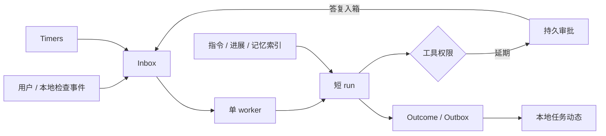

# 事件驱动的持续任务

假设一次检查报告 `expected=42, actual=41`。agent 先读报告并通知失败；稍后的定时跟进读到同一结果时保持安静；新的 CI 事件变成通过时再通知。需要改文件时，它保存准确的调用并结束本次 run，等用户批准后继续。程序重启不会把一次批准变成重复写入。

这组能力补在现有执行与进化闭环外围。一次 run 有时间和调用预算，完成后释放资源；跨 run 连续性来自持久事件、任务进展、记忆和投递记录。依据是 Anthropic 的 [Building always-on agents](https://claude.com/resources/articles/building-always-on-agents)。

[验收报告](reports/always-on-validation.md)区分离线机制、实际界面和真实 Step 的结果：核心八项通过，额外记忆整理补测尚未完成。



## 先运行离线示例

在项目根目录，用 **WSL Ubuntu** 或 **Windows PowerShell 7** 执行：

```sh
node docs/learn/examples/background.ts
```

示例使用实际 SQLite、JSONL、文件工具、定时器和审批，仅固定模型回复。所有数据在临时 home/project 内，无密钥、无远端请求。它证明连接方式和恢复规则；指定模型的能力需要另做真实验收。

## 创建和处理事件

CLI 使用已有模型配置，以下命令可在 **WSL Ubuntu / Windows PowerShell 7** 的项目根目录运行。先构建，再把返回的任务 ID 用于后续命令：

```sh
pnpm build
node dist/cli/main.js background create '跟进本地检查结果，有变化再通知'
node dist/cli/main.js background enqueue <task-id> --input check-result.json --source local-ci --event-id job-1
node dist/cli/main.js background run
node dist/cli/main.js background outbox
```

`check-result.json` 是要导入的 JSON 数据。`source + event-id` 相同且 payload 相同会去重；同 ID 不同内容会报冲突。同一任务的一批普通事件保持顺序，最多 16 条、64KB；审批答复独立处理。外部数据不能通过写“已批准”获得工具授权。

`run` 有界地处理当前待办；`serve` 显式启动持续轮询，Ctrl+C 会取消并等待本次工作清理。没有事件时不请求模型。当前没有开机启动、系统服务、远程 webhook 或外部消息渠道；进程关闭期间不执行，重启后按规则补跑。

## 定时器只负责入箱

```sh
node dist/cli/main.js background timer <task-id> --at 2026-11-16T09:00:00+08:00
node dist/cli/main.js background timer <task-id> --at 2026-11-16T09:00:00+08:00 --every-ms 3600000 --timezone Asia/Shanghai
node dist/cli/main.js background cancel-timer <timer-id>
```

时间必须带明确 UTC 偏移；存储使用 UTC，IANA 时区用于解析语义与展示。`every-ms` 是锚定的固定间隔，最小 1 秒。离线错过多个周期时只合并一个事件，记录 missedCount，再推进下一时刻；入箱与推进在同一事务内。取消递增 generation，旧事件在合批前失效。

日历型 cron、夏令时“每天当地 9 点”规则不在当前接口中。默认每任务最多 16 个活跃 timer，任务取消会同步停止定时触发。

## 准确审批与恢复

默认 inspect 任务仅有受限 read，没有 bash。要提出修改，创建时逐个列出文件：

```sh
node dist/cli/main.js background create '修复 sum.js 的加法' --edit-path sum.js
node dist/cli/main.js background approvals
node dist/cli/main.js background approve <request-id>
node dist/cli/main.js background run
```

也可以 `deny <request-id>`。授权只绑定这一调用及其参数、原 assistant entry、文件前置内容、用户范围和实现版本。文件变了、策略收紧了、实现版本不符或请求过期，旧授权不能执行。每次写入都重新审核；相同拒绝不会被新工具 ID 绕过。

例如一批工具是 A 读取、B 修改、C 读回。B 延期时，A 的结果已保存，B/C 均未执行。批准后先恢复 B/C，再调用模型；已经可靠保存的前缀不重跑。审批可以跨进程重启，但密钥仍需要通过当前连接重新提供。

**模型上下文可以压缩，审批消费证据必须留在原始 JSONL。** 即使摘要移除了 B 的结果，宿主仍按原 assistant entry 与准确 name/id 边界核对持久记录，避免任务永久停在等待状态，也避免把后来的 read 误认成 write。

桌面“持续任务”提供创建、处理待办、准确批准/拒绝、取消和已读。待确认时 run 已结束，worker 可以释放。普通会话 resume/compact 不能绕过已托管 session 的恢复入口。

## 记忆、进展与通知

每个新 run 获取当前用户指令、任务进展、最近已投递摘要和 MEMORY.md 索引，细节可按需 read。记忆内容是低信任数据，不能修改任务范围或替用户批准。恢复同一个中断 run 时复用已保存的有界数据快照；新 run 再刷新。

通知判断同时保留外部来源证据和工具实际观察。CI pass→fail 即使 read 的参考文件没变也通知；纯 timer 沿用最近来源证据，调度时间和工具调用 ID 不制造“变化”。返回先前状态也可以再次通知。模型换一种措辞不会单独触发发送。

run 结束、任务状态、检查结论、投递与已读分别记录。inspect 没有执行检查，不能把 `done` 写成“检查通过”。Outbox 的 delivered 表示本地动态已接受，seen 表示用户确认已读。投递失败持久记录退避，最多三次；重试投递不重跑 agent。

## 有边界的维护作业

```sh
node dist/cli/main.js background create '整理已完成会话的项目记忆' --kind dream
node dist/cli/main.js background create '为可靠 dev 失败生成候选' --kind evolution --max-calls 80 --max-tokens 100000 --timeout 180
```

维护任务同样由事件或 timer 触发，普通工作优先。dream 的范围明确包含项目记忆写入和 Git 快照，跳过未完成/未配对会话，不提供 bash；Git 不执行记忆仓库中的 hooks，凭据环境不下发给命令，调用有超时。

evolution 的事件 payload 使用 `{"evidenceRun":"evals/runs/<run>"}` 指向工作区内评测产物。CLI 高层先按可信任务定义识别 dev，要求至少两条正常结束、完整性有效的失败及可比较 provenance；损坏、越界、heldout 伪装或环境合同改变均不能启动优化。来源证据只触发门禁，候选仍从新鲜 dev 基线生成，经过配对确认和最终 heldout 审计。相同 dev 证据不重复付费，heldout 结果不引导再次搜索。

候选只成为可审阅产物；采用沿用已有显式选择流程。调度器、权限实现、评分器和源码不会自动改写。桌面展示维护状态，执行维护评测使用 CLI 后台服务。

## 失败与预算

默认每 run 最多 12 次 provider 调用、10 万已报告 token 门槛、180 秒；每任务最多 288 次调用，每天最多 144 次调用、24 个 run，默认 7 天到期。调用前持久预留，崩溃、错误或缺失 usage 的预留不会被重启清成零。调用额度统计 provider 调用，HTTP 重试需单独看；已在途请求可能超过已报告 token 门槛，未知定价不换算为美元。

进程退出后，事件与已完成结果可对账。若工具已产生副作用但结果未可靠保存，或维护作业没有完成标记，状态是 needs_reconciliation，不能自动重放任意操作。确认旧执行及后代已停止后，才可使用：

```sh
node dist/cli/main.js background recover-supervisor --confirmed-stopped
node dist/cli/main.js background recover <run-id> --confirmed-stopped
```

确认标志是操作者声明，不能拿超时替代停止证明；活进程的锁不会被接管。内置实现按进程代固定，更新代码需重启；插件沿用 run lease 热加载。Windows 与 WSL 使用各自的 home/控制库，不共享 WAL。权限护栏不能代替 OS 隔离，维护评测应使用可信的任务与检查资产。

源码入口：[worker](../src/app/background/worker.ts)、[store](../src/app/background/store.ts)、[审批](../src/app/background/approvals.ts)、[上下文](../src/app/background/context.ts)、[维护注入](../src/cli/background-jobs.ts)。
