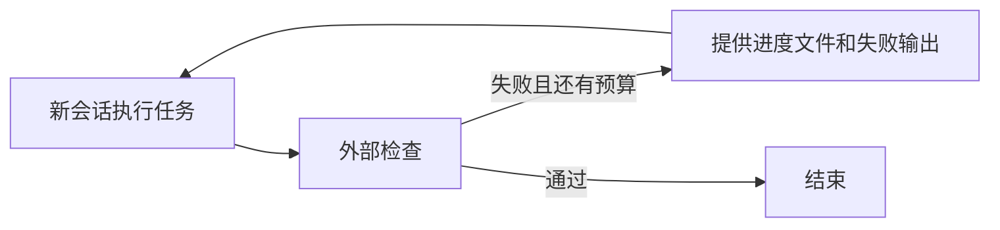

# 06 · 用检查结果驱动下一次修改

[学习路线](README.md) · 上一章：[上下文管理](05-context.md) · 下一章：[项目记忆](07-memory.md)

模型可以输出“已修复”，但文件能否运行要由实际检查判断。这一章把编辑、检查、反馈和继续修改接成一条有预算的流程。

## 把检查接在什么位置

内核提供四个 hooks，可以理解为预留的处理时机：

| 时机          | 当前用途               | 返回结果如何影响循环     |
| ------------- | ---------------------- | ------------------------ |
| `beforeModel` | 判断是否需要清理或摘要 | 可以替换本轮消息         |
| `beforeTool`  | 判断操作权限           | 可以拒绝执行并返回原因   |
| `afterTool`   | 编辑后检查、长输出转存 | 可以补充或替换工具结果   |
| `onStop`      | 模型准备结束时运行检查 | 可以追加反馈并要求下一轮 |

[composeHooks](../../src/hooks/compose.ts) 把不同能力组合起来：拒绝执行时提前返回，工具结果按顺序传递，任一结束检查要求继续就继续。[buildAgent](../../src/app/build-agent.ts) 负责注册，循环只依赖 hooks 接口。

## 一次失败怎样回到模型面前

假设项目设置了结束时运行测试，过程可能如下。这是说明机制的例子，具体输出由项目检查决定。

```text
模型修改 sum.cjs，准备结束
  → onStop 执行 node --test
  → 测试报告最后一个元素没有计入
  → 程序追加包含命令和失败输出尾部的消息
  → 模型重新读文件，修改循环边界
  → 再次准备结束，重新运行检查
```

[afterEditHook](../../src/hooks/after-edit.ts) 只处理成功的 write/edit 调用，按文件 glob 匹配检查。命令在项目根目录运行，通过 `MH_FILE` 环境变量接收目标文件绝对路径。失败输出追加到工具结果，标记错误；原本已经写入的文件不会自动回滚。

它无法自动捕获模型通过 bash 修改的所有文件。因此“编辑后检查”覆盖的是这两个文件工具，项目整体检查仍应安排在结束时或外部执行。

[stopCheckHook](../../src/hooks/stop-check.ts) 按配置顺序运行检查，遇到失败就把最后 3000 字符反馈给模型，默认最多要求继续修复 2 次。没有配置命令时，不会自动推断测试命令。

## 为什么结束检查要设置预算

检查可能一直失败，也可能本身不适合当前环境。无限要求修复会消耗时间和调用费用。

预算耗尽时，当前实现记录并显示未通过的检查，但返回停止决定。核心循环因此仍可能以 `done` 结束，打印模式也可能退出 0。**结束原因与验证结果没有统一成一个严格的成功状态**，使用者需要查看检查结果；这是当前实现的一项限制。

编写自动化时，应让外部任务检查给出最终判断。第八章的 eval 就使用独立检查，而不只依赖模型回复或 `done`。

## Ralph 为什么每次新建会话

Ralph 是外层的另一种循环：一次 agent 运行后执行 `--check`；失败就新建会话，把原始任务、进度文件路径和上次检查输出尾部交给模型。



默认最多 5 次迭代，每次最多 50 轮。进度文件 `ralph-progress.md` 由模型维护，用于跨会话传递发现和下一步。外层不会把每次完整历史叠加进下一个会话。

连续两次检查失败在去掉时间戳、规范化尾部空白后相同，Ralph 会以 `stuck` 停止；次数耗尽、中断和模型运行错误也有不同结束原因。它减少重复尝试，但相同错误仍可能对应不同的内部进展，因此只是简单的停滞判断。

## 项目提供的检查命令也要有信任边界

hooks 会执行 shell，所以首次使用项目配置要确认信任。信任记录绑定规范化配置的 hash，命令变化后重新确认；无人值守时忽略未信任的项目 hooks 并警告，`--trust-project` 可显式信任。全局配置中的 hooks 视为可信。

这解决“是否采用项目提供的命令”，操作本身的范围仍由权限和系统隔离决定。

## 怎样验证这一步

在项目根目录的 PowerShell 7 或 WSL Ubuntu bash 中执行：

```sh
node --import ./test/helpers/setup.ts --test test/unit/hooks/feedback.test.ts test/unit/hooks/permission.test.ts
```

重点看 `failing check continues with output tail`、`exhausted after maxStopContinuations`、`each iteration starts a fresh context` 和 `stops when same failure twice in a row`。测试检查的是反馈是否进入下一轮，以及循环是否按预算结束。

源码阅读顺序：[compose.ts](../../src/hooks/compose.ts) → [after-edit.ts](../../src/hooks/after-edit.ts) → [stop-check.ts](../../src/hooks/stop-check.ts) → [ralph.ts](../../src/app/ralph.ts)。

思考题：模型最后一轮修复了问题，但已经达到轮数上限，为什么仍值得让外部检查运行一次？“有没有完成自然语言总结”与“文件是否通过检查”应当分别观察。

下一章：[把跨会话有用的信息整理成项目记忆](07-memory.md)。
