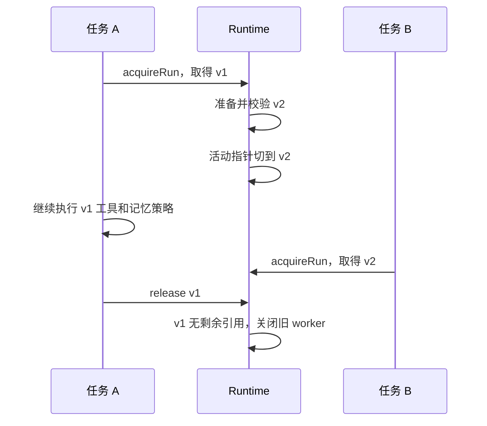

# 09 · 用快照和热加载控制版本生效

[学习路线](README.md) · 上一章：[能力组合](08-composition.md) · 下一章：[评测与改进](10-evaluation.md)

一个候选通过评测后，还需要正确进入下一次任务。假设模型已经按照 v1 的工具定义发出调用，此时磁盘更新为 v2：若立即替换执行函数，就可能用新实现处理旧参数。热加载因此需要明确版本边界，不能只靠监听文件变化。

## 一次 run 是什么

一次 `startRun()` 从用户输入开始，包含多次模型请求、工具调用、结束检查与成功后的记忆写回。运行中排队的 steering 消息也属于它。一个 session 可以包含多次 run。

版本在完整 run 之间切换；同一个 run 内继续持有原快照。交互中的 `/profile`、`/reload` 在空闲时处理；程序调用的 `runtime.reload()` 可以准备新版本，同时让旧 run 完成。



## 快照必须同时包含什么

[RuntimeSnapshot](../../src/app/runtime.ts) 同时固定配置、选择顺序、基础提示词、项目说明、插件源码身份和贡献对象。运行时不会只更新一个工具 Map，而保留旧 prompt 或旧 hooks。

三个 hash 回答不同问题：

| 标识         | 用途                                                  |
| ------------ | ----------------------------------------------------- |
| `id`         | 判断完整运行组合是否改变，决定是否重新组装稳定 system |
| `actorHash`  | 标识非提示词的组合与插件实现，供实验条件比较          |
| `promptHash` | 标识基础 prompt bundle 的内容，区分候选文本           |

插件 prompt 片段来自插件代码，其变化会改变插件指纹，不能被当作只修改基础 system.md 的同条件实验。基础提示词变化则应允许与原版比较，否则优化器永远无法评测自己的候选。

## 源码文件怎样成为可以执行的插件

[plugin-loader.ts](../../src/app/plugin-loader.ts) 读取 `mh-plugin.json` 及显式声明的文件，校验普通相对路径、文件数量和大小，再计算内容指纹。导入前先按该指纹检查授权；授权期间文件发生改变也会拒绝。

获批源码复制到独立的数据目录，校验副本后才启动 worker。入口和本地依赖文件都进入副本，新的 generation 使用新的 worker，从而获得独立的模块缓存和模块级状态。简单给 ESM import URL 加时间戳，不能保证整个依赖图和资源都随之替换。

[plugin-worker.ts](../../src/app/plugin-worker.ts) 通过有 ID 的消息处理工具、上下文、记忆和 hooks 调用。函数留在 worker 内；消息、参数和返回数据被序列化，取消信号由宿主转发。初始化、调用、输出大小和 pending 数量有明确上限。

worker 是模块与生命周期边界，不是操作系统沙箱。常规 `child_process/cluster` 入口不属于插件契约，命令交给宿主 bash 工具。加载信任覆盖模块初始化代码；工具调用审批则约束具体动作，两者发生在不同阶段。

## 为什么需要 acquire 与 release

`acquireRun()` 返回一份 lease：快照引用与 `release()`。旧版本即使已经不再是活动版本，只要还有 lease 就不能 dispose。

下面是调用关系的伪代码，完整错误处理见 [startRun](../../src/app/run.ts)：

```text
lease = await runtime.acquireRun()
try:
  config = buildAgent(lease.snapshot, 当前会话)
  执行模型和工具循环
  成功后执行同版本的 remember
finally:
  await lease.release()
```

关闭宿主时，应先取消并等待自己的运行任务，释放手动取得的 lease，再 `await runtime.close()`。`finally` 既覆盖正常结果，也覆盖模型错误、工具中断和记忆失败。

## 重载失败怎样处理

准备阶段先创建完整候选：读配置、检查选择、授权源码、启动 worker、校验贡献。全部成功后才替换活动指针；失败时释放候选资源并保留旧版本。

例如输入 `/profile missing` 不会把已运行的 v2 清空。旧版本继续接受新任务，状态中保留错误信息。更新插件代码需要重新授权，名称相同或只改 version 都不能代替内容身份。

`--watch` 按 500ms 间隔检查输入变化，标记 dirty；下一次 acquire 才尝试 reload。它能发现编辑器的原子保存和声明文件增删，但不会在一个模型响应或工具批次中途改版本。手动 reload 仍然是明确的恢复入口。

## 会话怎样解释自己使用过的版本

[run.ts](../../src/app/run.ts) 在版本变化时写 runtime trace，并保存实际稳定 system、基础 prompts、工具定义和组合元数据。仅记录 hash 而不保存实际内容，无法解释过去到底执行了什么。

临时检索文字不因此写成独立历史消息。评测还保存实际模型请求中的 system/tools，便于核对动态输入与最终工具描述。恢复历史不会重新执行旧工具或记忆写回；新的 run 使用当前明确选择的版本，并记录变化。

## 运行与验证

项目根目录，PowerShell 7 或 WSL Ubuntu bash：

```sh
node docs/learn/examples/runtime.ts
node --import ./test/helpers/setup.ts --test test/unit/app/plugin-loader.test.ts test/unit/app/runtime.test.ts test/unit/app/runtime-cli.test.ts
```

示例前五条输出依次展示：v2 准备好、旧 lease 仍用 v1、同 session 新 run 使用 v2、错误组合保留旧版、profile 改变工具范围。这里验证的是加载与切换机制，版本更好与否需要下一章的独立任务结果。

源码阅读顺序：[plugin-loader.ts](../../src/app/plugin-loader.ts) → [plugin-worker.ts](../../src/app/plugin-worker.ts) → [RuntimeManager](../../src/app/runtime.ts) → [startRun](../../src/app/run.ts) → [REPL](../../src/cli/repl.ts)。

思考题：新版本启动失败时，应该先停掉旧 worker 吗？如果调用方忘记 release，会发生什么？为什么评测的每个 attempt 还需要单独创建 worker？

下一章：[固定版本与检查标准，再判断改动有没有帮助](10-evaluation.md)。
