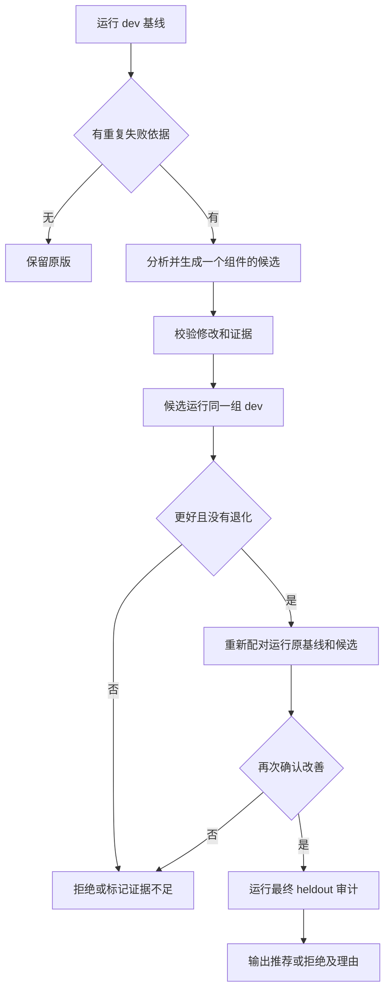

# 11 · 从任务证据到可采用的提示词版本

[学习路线](README.md) · 上一章：[评测与改进](10-evaluation.md)

自进化把执行、证据、候选、评测与版本管理接成闭环：提出受限修改，运行任务，独立判断，再让通过验证的版本进入下一次运行。生成器与采用规则由不同模块负责。

先看一个具体例子。受控 `ACK_ONLY` 系统提示要求只回复确认语、禁止调用工具；Step 的两次 dev 尝试正常结束但都没有完成修复。优化器读到失败后提出通用执行指令。候选在 dev、新一轮确认及 heldout 各通过 2/2，产物加载后的新任务也通过检查。结果验证这一缺陷下的完整流程，不等于默认 prompt 的性能提升，详见[真实验收报告](../reports/pluggable-runtime-validation.md)。

这里真正学习的是可替换的提示词文本。模型权重、工具实现、任务答案和评分标准固定；生成模型说“更好了”也不能代替任务检查。

## 先固定哪些东西可以变化

[candidate.ts](../../src/eval/candidate.ts) 定义允许优化的最大范围：`system.md` 和四个内置工具说明。[evolve.ts](../../src/eval/evolve.ts) 再按实际 profile 过滤：未启用 edit，就不能优化 edit 的说明。一次提案只改一个组件，其他 prompt 内容必须与父版本一致。

以修改 `tools/edit.md` 为例，程序检查目标是否非空、长度是否超限、原有模板变量是否完整、是否偷偷改了 `judge.md`，还会拒绝符号链接和已经评测过的相同内容。Windows PowerShell 回退会覆盖 bash 描述，所以该模式不能把磁盘上的 `tools/bash.md` 当作有效优化目标。

这一步把“只改一个组件”变成代码约束。如果生成器可以同时修改评分器，观察到的高分就无法说明任务能力发生了变化。

## 将失败变成可以核对的提案

[PromptOptimizer](../../src/eval/optimizer.ts) 只约定候选生成：`id`、`version` 和 `propose`。默认 evidence 实现使用 analyzeRun，也可以由程序调用者替换；无论使用哪个生成器，后续验证和判优仍由 evolve 执行。运行插件在 app 层装配，优化器在 eval 层注册，避免运行层反向依赖评测层。

[analyzeRun](../../src/eval/analyze.ts) 只准备开发数据：可分析的失败、最多两条成功对照，以及提示词副本。环境中断、准备故障和 judge 错误不会直接转成提示词补丁。模型只能读取明确暴露的输入，写入选中的目标、`analysis.md` 与 `proposal.json`。

`proposal.json` 包含修改假设、原因类别、证据引用、预期改善与退化风险。证据引用必须能在真实记录中找到；修改需要至少两个失败 attempt 的支持。这里的两次尝试可以来自同一任务的重复运行，程序验证的是证据存在，不能自动证明两个失败确实有共同原因。

例如：“两个任务都因编辑文本匹配不唯一而失败”只是一个假设。引用相应工具错误后，可以尝试在说明中补充“先读取上下文，再提供唯一匹配片段”。候选是否改善仍由后续任务执行决定。

## 提案、选择和采用分别判断



[gate.ts](../../src/eval/gate.ts) 按任务 ID 和 attempt 配对。候选把之前失败的尝试修好、又没有让原本通过的尝试失败，才有晋级依据。执行错误、无效判决或缺失结果输出 `inconclusive`。即使最终文件碰巧通过检查，`endReason:error` 也不构成可靠的改善证据。

初始基线可能偶然失败，所以最终候选还要与原版进行一次新的完整 dev 配对确认。若两版这次都通过，就不能只凭第一次差异推荐。两次重复仍然很少；这是一项工程验证，不能等同于统计显著性。

搜索与选择都使用 dev。Heldout 只在候选固定后参与审计，其失败不会送回优化器；如果以后根据它继续调整提示词，就需要新的独立测试数据。

## 怎样确认两版真的可以比较

[provenance.ts](../../src/eval/provenance.ts) 对任务与 fixture、评分器、实际模型配置、源码、运行时和关键执行环境生成 hash。[compare.ts](../../src/eval/compare.ts) 检查这些条件与结果全集，拒绝把缺失、重复或条件不同的结果作为自动判优依据。

另外保存实际模型请求中的 system/tools，便于判断候选是否真正进入请求。任务通过 `protectedFiles` 声明独立检查资产；agent 执行前后内容变化、删除或路径替换都使评测无效。业务代码可以修改，独立评分代码需要保护，二者由任务定义明确区分。

这仍然是目录、权限和完整性检查，不是操作系统沙盒。公开题库也无法靠文件访问限制保证永远不被模型或使用者记住。

## 给搜索设置预算并保留失败

[evolution-budget.ts](../../src/eval/evolution-budget.ts) 分别记录任务模型、优化器和 judge 的调用与报告用量。摘要请求计入任务模型。达到调用数、报告 token 或时间限制就停止后续工作；已经在途的请求可能产生额外用量。

错误流可能没有报告最终 token，所以“收到一个错误回复”不能解释为用量完整或费用为零。缺少可靠价格时费用保持未知。一次 provider 调用还可能包含 HTTP 重试，报告时需说明计数口径。

[evolve.ts](../../src/eval/evolve.ts) 保存每轮父版本、候选和选择理由。候选重复、没有修改依据或持续无改善时停止；默认提示词始终由显式选择控制。没有新的可归因失败时，`insufficientEvidence` 可以停止继续搜索，但不否定已经通过确认和审计的候选；最终 decision 与停止原因分别解释。

## 从推荐结果到运行版本

`recommend` 和 `unchanged` 才生成 [prompt-artifact](../../src/eval/prompt-artifact.ts)：记录整体 hash、12 个基础 prompt 文件的逐项 SHA256、父 hash、优化器身份与相对目录。`recommend` 选择确认和审计通过的候选，`unchanged` 选择原基线。

目标 profile 显式指定 `promptArtifact`，由 [prompt-selection](../../src/app/prompt-selection.ts) 核对文件与 hash，然后用第九章的 reload 激活。正在执行的 run 继续旧版本。hash 证明加载内容没有漂移，是否值得采用则来自独立评测证据；手写一个 decision 字段不能代替实验。

这一刻闭环才完成：任务产生证据，证据产生候选，评测产出版本，runtime 将它用于新任务。项目默认提示词不会被优化器直接覆盖。

## 先运行完整的离线闭环

项目根目录，PowerShell 7 或 WSL Ubuntu bash：

```sh
node docs/learn/examples/evolution.ts
```

[示例](examples/evolution.ts)固定 actor 和 optimizer 的回复，实际使用独立工作区、受保护 Node 检查、analyze、候选校验、gate、新鲜确认和 heldout 审计。随后校验产物、reload，再发起新 run 检查采用的 prompt 和文件结果。所有文件位于临时目录，退出时清理，禁止网络请求。

脚本化 actor 知道演示答案，所以它只证明这些模块正确连接。模型能否自行提出有效候选，需要前述真实验收；广泛能力提升仍需要更多独立任务。

## 运行与验证

在项目根目录的 PowerShell 7 或 WSL Ubuntu bash 中执行离线行为测试：

```sh
node --import ./test/helpers/setup.ts --test test/unit/eval/candidate.test.ts test/unit/eval/gate.test.ts test/unit/eval/evolve.test.ts test/unit/eval/integrity.test.ts
```

重点看三个用例：`evolution requires the apparent improvement to survive fresh dev confirmation` 验证偶然差异不能推荐；`evolution cannot recommend when both heldout judge responses are invalid` 验证评分错误不会漏过；`evolution does not reevaluate a duplicate candidate` 验证去重节省调用。

配置好模型连接后，可以在同一目录运行：

```sh
node src/cli/main.ts evolve --provider anthropic --model step-5-preview --repeat 2 --rounds 3 --candidates 2 --targets system.md,tools/edit.md --max-calls 200 --max-tokens 1000000 --timeout 1800
```

结果目录中的 `report.md` 给出 `recommend`、`unchanged`、`reject` 或 `inconclusive`；候选提示词、原始记录和资源账本各自留存。`recommend` 表示这次实验符合采用规则，不会自动替换默认提示词。

提示词子系统的真实验收使用 [evolution.test.ts](../../test/live/evolution.test.ts)，包含正常基线和受控修复，需要显式开启 `MH_LIVE_EVOLUTION=1`。冻结 runtime、发布产物并在采用后发起新任务的真实验收使用 [runtime-evolution.test.ts](../../test/live/runtime-evolution.test.ts)，门控为 `MH_LIVE_RUNTIME_EVOLUTION=1`。两者都需要按脚本配置模型、端点、临时凭据与独立输出目录；实际结果分别见[提示词报告](../reports/prompt-evolution-validation.md)与[版本采用报告](../reports/pluggable-runtime-validation.md)，不同模型和实验不合并分数。

源码阅读顺序：[candidate.ts](../../src/eval/candidate.ts) → [analyze.ts](../../src/eval/analyze.ts) → [gate.ts](../../src/eval/gate.ts) → [evolution-budget.ts](../../src/eval/evolution-budget.ts) → [evolve.ts](../../src/eval/evolve.ts)。算法来源与取舍见[设计说明](../prompt-evolution-design.md)。

思考题：候选只在第一次 dev 测试变好，第二次与原版相同，应当宣布提升吗？一个服务在候选复测中途返回 401，这些失败应该指导提示词修改，还是先保留为不可用的实验记录？
