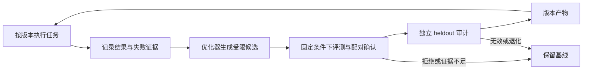
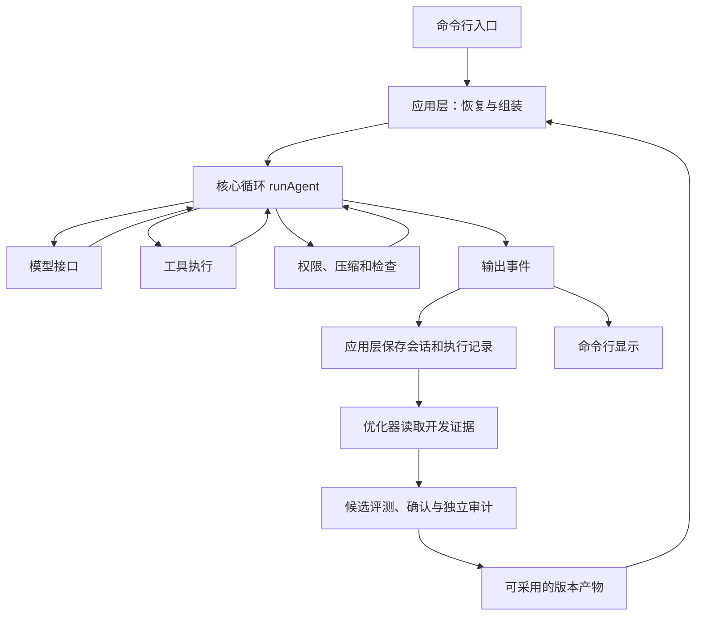

# 构建可自进化的 Agent Harness

这组教程围绕一个目标组织：让编码 agent 的失败能够变成有证据的改进提案，并让通过验证的版本进入下一次运行。执行、记录、组合、评测和版本采用共同构成 harness；自进化闭环建立在这些明确的接口与约束上。

假设你已经能读 TypeScript，了解 `async/await` 和基本的 HTTP。模型协议、工具调用和实验方法会在用到时解释。三个离线示例可以在没有密钥时运行，分别展示执行、组合与完整进化流程。

## 先看自进化闭环

例如一份错误的提示词要求模型只回复确认语，导致修复任务失败。优化器读取失败轨迹，提出“检查文件、执行修改、验证结果”的通用候选；评测器运行候选并重新配对确认，最后审计独立任务。只有经过这一过程，候选才成为可以显式加载的新版本。



这是一条受限的提示词进化闭环：自动变化的对象是 system.md 和实际启用的内置工具说明。模型权重、评分器、工具实现以及上下文和记忆算法保持固定；它们可由开发者组合，但没有被描述成会自动重写自己的系统。

## 沿着闭环读源码

| 章节                                            | 要回答的问题                       | 为进化闭环提供什么                 |
| ----------------------------------------------- | ---------------------------------- | ---------------------------------- |
| [01 · 核心循环](01-loop.md)                     | 模型怎样执行任务并接收真实结果？   | 固定的执行内核与停止条件           |
| [02 · 工具与边界](02-tools.md)                  | 哪些动作能执行，失败如何表达？     | 工具契约、权限与进程管理           |
| [03 · 模型接口](03-providers.md)                | 怎样保留协议、错误和实际用量？     | 可替换模型与可靠的调用记录         |
| [04 · 会话与恢复](04-sessions.md)               | 发生了什么，如何重建？             | 可追查的消息与 trace               |
| [05 · 上下文管理](05-context.md)                | 长任务怎样保留有效信息？           | 稳定输入、清理、摘要与缓存观测     |
| [06 · 检查反馈](06-feedback.md)                 | 单次任务如何根据检查继续修复？     | 确定性反馈与继续预算               |
| [07 · 项目记忆](07-memory.md)                   | 哪些经验进入后续任务？             | 文件索引、按需召回与整理           |
| [08 · 能力组合](08-composition.md)              | 实验中哪些能力可选，哪些必须固定？ | profile、插件与明确的变化范围      |
| [09 · 版本与热加载](09-runtime.md)              | 新版本何时生效，失败怎样保留旧版？ | 不可变快照、lease 与事务式重载     |
| [10 · 评测与改进](10-evaluation.md)             | 两次结果怎样比较才可信？           | 独立目录、实验合同与资产保护       |
| [11 · 提示词进化与采用](11-prompt-evolution.md) | 什么候选值得保留并进入下一次运行？ | 优化器、gate、确认、审计与产物加载 |

每章都围绕一个具体问题说明取舍、源码入口与验证。文中的片段和伪代码用于解释契约，完整可运行程序放在 examples/。按顺序阅读时，会先了解执行与版本边界，再判断改进是否成立。

## 先运行三个离线例子

在项目根目录执行。Windows 使用 PowerShell 7，WSL 使用 Ubuntu bash；依赖安装在各自实际使用的平台。后两个例子需要 Node 24、Git 和可用 shell，不需要模型密钥。

```sh
pnpm install
node docs/learn/examples/loop.ts
node docs/learn/examples/runtime.ts
node docs/learn/examples/evolution.ts
```

| 示例      | 会看到什么                                   | 使用的真实实现                                    |
| --------- | -------------------------------------------- | ------------------------------------------------- |
| loop      | read 调用及结果回传                          | 内核与参数校验；文件位于内存                      |
| runtime   | v1/v2 切换、旧任务完成与错误组合回退         | worker、工具、上下文、记忆、hooks 与会话          |
| evolution | 基线失败、候选验证、确认、heldout 与版本采用 | 真实任务检查、优化编排、gate、artifact 与 runtime |

模型回复被固定脚本替代，因此这些输出证明的是程序连接方式，不是模型能力。后两个例子使用临时目录和显式 home，清理后退出，不读写项目配置或个人模型数据，也不调用远程 API。真实 Step 结果及其受控实验范围见[验收报告](../reports/pluggable-runtime-validation.md)。

随后可以运行完整离线检查：

```sh
pnpm check
```

各章还给出只运行相关测试文件的命令。命令包含 `--import ./test/helpers/setup.ts`，用于设置临时数据目录并限制远程网络访问；模型接口测试使用本地 HTTP 服务。需要运行进程、记忆或评测相关测试时，系统还应安装 Git 和可用 shell。

## 系统怎样组装

先认清执行、版本和优化三个边界，就能找到一次改进经过的代码：

| 入口                                       | 负责什么                               | 阅读时看什么                                         |
| ------------------------------------------ | -------------------------------------- | ---------------------------------------------------- |
| [main](../../src/cli/main.ts)              | 接收参数、找到项目、选择会话和交互方式 | `cwd`、`home`、配置和中断信号从哪里来                |
| [startRun](../../src/app/run.ts)           | 恢复消息、追加用户输入、保存运行记录   | 消息如何进入会话，事件如何保存                       |
| [buildAgent](../../src/app/build-agent.ts) | 组合模型、工具、系统提示和 hooks       | 能力如何接入循环，为什么不用内核直接 import 文件工具 |
| [createRuntime](../../src/app/runtime.ts)  | 装配与管理运行版本                     | 同一 run 为什么不会混用两个插件版本                  |
| [runEvolution](../../src/eval/evolve.ts)   | 生成候选并组织独立验证                 | 为什么生成器不能决定自己的修改是否采用               |



图中的箭头表示调用或数据流。源码依赖还有更严格的规则：模块只依赖较低层或本目录；同层不同目录通过应用层组合。比如内核依赖工具的接口，实际工具由 `buildAgent` 传入。

核心循环和模型接口不直接操作文件、子进程或终端；模型接口可以使用 fetch。所有运行显式接收目录参数，禁止 `process.chdir`。这样测试可以换成固定回复，也能让多个评测任务使用各自的目录。[分层检查脚本](../../scripts/check-layers.ts)会自动检查这些规则。

## 怎么阅读每一章

每章包含问题、具体例子、设计取舍、源码入口和验证。建议先沿“源码阅读顺序”看一遍，再运行测试，观察断言究竟检查了什么。

教程区分三类证据：

- **固定回复示例与离线测试**：证明程序收到特定输入后会怎样行动。
- **真实模型测试**：证明指定端点与模型在该次运行中能走通流程，需要自行配置环境变量。
- **任务评测**：统计一组任务的检查结果，用于比较候选修改；结论受任务数量、难度和运行条件限制。

离线测试通过不能直接证明模型更聪明；一次真实任务成功也不能证明普遍有效。第十章会解释如何据此组织结论。

## 读完后可以自己讲清楚什么

- 为什么 agent 需要一个工具结果回传循环，哪些停止条件必须由程序处理。
- 为什么统一模型协议时仍要保存部分原生响应数据。
- 为什么会话历史、当前上下文和跨会话记忆需要分别管理。
- 检查怎样影响模型的下一步，以及预算耗尽时有什么限制。
- 怎样从任务结果和执行记录判断一次改动的收益与代价。
- 为什么插件可组合不等于所有策略都自动进化，以及候选怎样经过验证成为下一次运行的版本。

原始参考文章及借鉴点集中放在[项目 README 文末](../../README.md#参考资料与借鉴)。

开始阅读：[01 · 让模型和工具形成循环](01-loop.md)。
