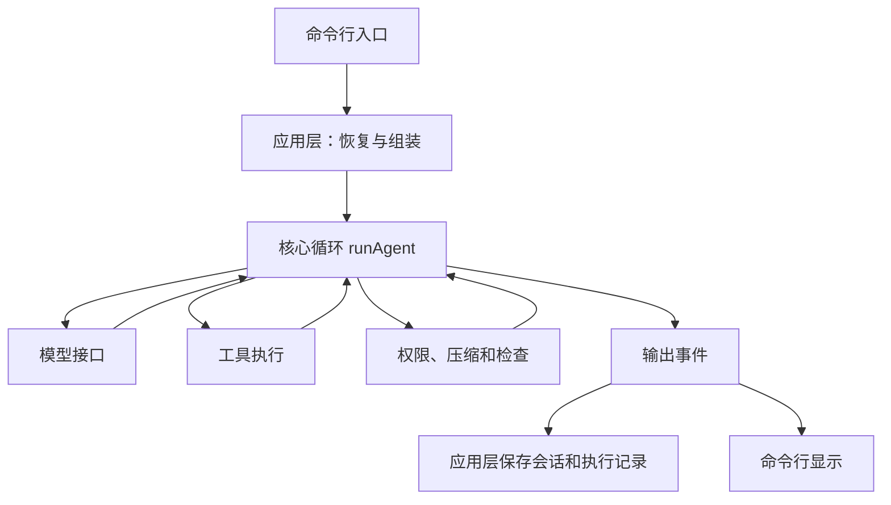

# 从最小循环到完整 Agent Harness

这组教程沿着 mini-harness 的实际代码，解释一个编码 agent 怎样从“调用一次模型”发展成可以执行工具、恢复工作、处理长对话并验证结果的系统。

假设你已经能读 TypeScript，了解 `async/await` 和基本的 HTTP。模型接口、工具调用和上下文管理会在用到时解释。阅读时不需要模型密钥；第一章示例和各章的离线测试可以直接运行。

## 一条逐步增加能力的路线

用“读取代码并修复测试”贯穿整条路线。每加入一个模块，都先说明当前系统遇到了什么问题，再看代码如何解决。

| 章节                                | 这一步要回答的问题                       | 新加入的能力                                |
| ----------------------------------- | ---------------------------------------- | ------------------------------------------- |
| [01 · 核心循环](01-loop.md)         | 模型提出调用工具后，程序怎么继续？       | 消息、工具调用、结果回传和停止条件          |
| [02 · 工具与执行边界](02-tools.md)  | 如何把模型的请求变成真实文件操作和命令？ | 四个工具、参数校验、权限与进程管理          |
| [03 · 模型接口](03-providers.md)    | 两种模型协议怎样共用一个循环？           | 统一接口、流式解析、最终用量、错误和重试    |
| [04 · 会话与恢复](04-sessions.md)   | 程序关掉后，怎样接着上一次工作？         | JSONL、事件记录、上下文重建和未完成调用修复 |
| [05 · 上下文管理](05-context.md)    | 日志和历史越来越长，怎么留住有用的信息？ | 稳定前缀、服务端缓存、长输出转存和摘要      |
| [06 · 检查反馈](06-feedback.md)     | 模型说改好了，程序怎样检查并要求继续？   | hooks、结束检查和 Ralph 跨会话循环          |
| [07 · 项目记忆](07-memory.md)       | 哪些经验值得带到下一次会话？             | Markdown 索引、按需读取和 dream 整理        |
| [08 · 评测与改进](08-evaluation.md) | 修改设计或提示词后，怎样判断有没有帮助？ | 独立任务、开发/保留任务划分、失败分析和比较 |

这些章节是理解当前实现的构建顺序。每章链接到同一份完整源码；文中的简化代码会标为伪代码，运行示例直接复用项目内核。

想追踪一个完整的排查案例，可以沿第三章的流式最终用量、第五章的稳定缓存前缀，再读第八章的隔离与指标。配套的[提示缓存排查指南](../prompt-caching.md)提供原厂依据、网关兼容配置、阶跃实测样例和可复跑入口。

## 先运行一次最小循环

在项目根目录执行。Windows 使用 PowerShell 7，WSL 使用 Ubuntu bash，两边的命令相同；依赖安装在各自实际使用的平台。

```sh
pnpm install
node docs/learn/examples/loop.ts
```

示例用固定脚本替代模型回复，用内存中的 `answer.txt` 替代磁盘文件；`runAgent`、工具参数校验、执行和结果回传都使用真实代码。它不访问网络、不读写项目文件，也不加载用户的模型配置。

随后可以运行完整离线检查：

```sh
pnpm check
```

各章还给出只运行相关测试文件的命令。命令包含 `--import ./test/helpers/setup.ts`，用于设置临时数据目录并限制远程网络访问；模型接口测试使用本地 HTTP 服务。需要运行进程、记忆或评测相关测试时，系统还应安装 Git 和可用 shell。

## 系统怎样组装

先认清三个入口，就能沿着一次请求找到大部分代码：

| 入口                                       | 负责什么                               | 阅读时看什么                                         |
| ------------------------------------------ | -------------------------------------- | ---------------------------------------------------- |
| [main](../../src/cli/main.ts)              | 接收参数、找到项目、选择会话和交互方式 | `cwd`、`home`、配置和中断信号从哪里来                |
| [startRun](../../src/app/run.ts)           | 恢复消息、追加用户输入、保存运行记录   | 消息如何进入会话，事件如何保存                       |
| [buildAgent](../../src/app/build-agent.ts) | 组合模型、工具、系统提示和 hooks       | 能力如何接入循环，为什么不用内核直接 import 文件工具 |



图中的箭头表示调用或数据流。源码依赖还有更严格的规则：模块只依赖较低层或本目录；同层不同目录通过应用层组合。比如内核依赖工具的接口，实际工具由 `buildAgent` 传入。

核心循环和模型接口不直接操作文件、子进程或终端；模型接口可以使用 fetch。所有运行显式接收目录参数，禁止 `process.chdir`。这样测试可以换成固定回复，也能让多个评测任务使用各自的目录。[分层检查脚本](../../scripts/check-layers.ts)会自动检查这些规则。

## 怎么阅读每一章

每章包含问题、具体例子、设计取舍、源码入口和验证。建议先沿“源码阅读顺序”看一遍，再运行测试，观察断言究竟检查了什么。

教程区分三类证据：

- **固定回复示例与离线测试**：证明程序收到特定输入后会怎样行动。
- **真实模型测试**：证明指定端点与模型在该次运行中能走通流程，需要自行配置环境变量。
- **任务评测**：统计一组任务的检查结果，用于比较候选修改；结论受任务数量、难度和运行条件限制。

离线测试通过不能直接证明模型更聪明；一次真实任务成功也不能证明普遍有效。第八章会解释如何据此组织结论。

## 读完后可以自己讲清楚什么

- 为什么 agent 需要一个工具结果回传循环，哪些停止条件必须由程序处理。
- 为什么统一模型协议时仍要保存部分原生响应数据。
- 为什么会话历史、当前上下文和跨会话记忆需要分别管理。
- 检查怎样影响模型的下一步，以及预算耗尽时有什么限制。
- 怎样从任务结果和执行记录判断一次改动的收益与代价。

原始参考文章及借鉴点集中放在[项目 README 文末](../../README.md#参考资料与借鉴)。

开始阅读：[01 · 让模型和工具形成循环](01-loop.md)。
