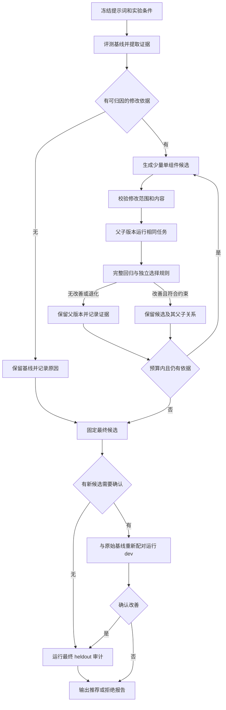

# 提示词自进化：源码调研与最小设计

> 状态：第一版已实现，验收记录见 [实施计划](prompt-evolution-plan.md)。调研日期：2026-11-09。本文区分已实现的最小循环与后续扩展；源码调研本身不构成效果实测。

第一版在现有 `analyze → eval → compare` 外加入有预算的离线优化循环：从执行证据提出小幅提示词修改，用实际任务比较父版本与候选，保留经过验证的版本。实现继续使用 TypeScript 和现有评测器。

例如，若多个任务都因 `edit` 的定位文本不唯一失败，可以提出修改工具说明的假设：“编辑前读取足够上下文，提供唯一匹配片段”。它先成为独立候选；只有在相同任务上减少失败、且没有破坏原有成功行为时，才值得推荐。这个例子用于说明机制，不代表当前工具说明已经存在该缺陷。

## 1. tRPC 中实际存在的机制

对应仓库是 **tRPC-Agent-Python**，优化入口为 `AgentOptimizer`。另一个 `trpc-group/trpc-python` 是 RPC 框架。这里更准确的术语是“反思驱动的提示词迭代优化”和“回归验证”。

核实版本：`trpc-group/trpc-agent-python@905698c243d8aa84c0f87c3449ebe773efc7ee82`，许可为 Apache-2.0，第三方组件按各自许可提供。

| 层次       | 源码实际行为                                                                                 | 本项目可以借鉴什么                     |
| ---------- | -------------------------------------------------------------------------------------------- | -------------------------------------- |
| 可优化对象 | `TargetPrompt` 显式注册文件或读写回调；写入要求字段集合一致                                  | 明确哪些文件可以变化，其他组件固定     |
| 算法       | `GepaReflectiveOptimizer` 直接调用 `gepa.optimize`                                           | 参考 GEPA 的反思、候选竞争与验证流程   |
| 反馈       | adapter 将输入、输出、指标原因和可用轨迹整理为反思材料，还可提供其他提示词组件和历史较好回答 | 失败证据与成功对照一起交给生成器       |
| 候选执行   | 每次评测前应用候选，业务端重新加载提示词                                                     | 确认实际发送给模型的文本确实发生变化   |
| 外层验收   | `eval_optimize_loop` 示例对 baseline/candidate 分别做 train/validation 回归，再运行独立 Gate | 优化器运行完成与候选值得采用分别判断   |
| 留存与写回 | 保存提示词快照、案例差异与决策；示例写回默认关闭，开启时检查源文件 hash 和写后读回           | 输出可审阅候选、完整证据和可恢复的版本 |

核心源码：[目标注册][trpc-target]、[GEPA 调用][trpc-gepa]、[反思数据][trpc-feedback]、[外层 Gate][trpc-gate]、[写回保护][trpc-writeback]。

源码核对揭示了几项不能直接照搬的细节：

- SDK 的 `update_source=False` 只控制最终是否保留修改。优化期间 adapter 仍会覆盖注册的目标，最后恢复基线。本项目应继续使用独立候选目录，避免探索过程影响正在使用的提示词。
- SDK 的 `SUCCEEDED` 表示优化过程正常返回，预算耗尽或无改善也可能得到该状态；它本身不保证候选严格优于基线。独立 Gate 位于示例层，不能混同为 SDK 默认保障。
- `baseline_pass_rate` / `best_pass_rate` 实际来自 GEPA 验证聚合分数；adapter 可以使用连续指标均值，因此它们不一定是“通过任务数 / 全部任务数”。本项目应单独保存任务通过率、执行结束原因和可选 judge 分数。
- SDK 的部分资源字段仍是占位值，例如 judge 次数与费用为零，token 聚合主要来自反思模型。不能据这些字段断言整个优化过程的费用为零或已完整统计。
- train/validation 的路径分离不等于内容独立；validation 参与搜索和选优，也不等于最终未使用的测试集。

对应证据：[优化 facade][trpc-facade]、[评测时应用候选][trpc-evaluate]、[分数映射][trpc-score]、[结果状态][trpc-result]、[资源统计][trpc-usage]。

## 2. 其他开源实现的取舍

以下均核对了实现源码。表中的“借鉴”是本设计的选择，不代表这些项目都具有相同的完整闭环。

| 项目             | 已核实的机制                                                                                           | 建议借鉴                                       | 暂不引入                                                             |
| ---------------- | ------------------------------------------------------------------------------------------------------ | ---------------------------------------------- | -------------------------------------------------------------------- |
| **GEPA**         | 选择父候选、执行训练小批、根据轨迹修改一个组件、在同批上评测子候选；通过接受条件后执行验证、维护候选池 | 同批父子比较、组件级修改、保留旧版本、显式预算 | 完整 Pareto 搜索、merge 和大种群                                     |
| **LangMem**      | 梯度式优化先输出是否值得调整、假设和建议，再做最小改写；无证据时保持原文；校验原有模板变量             | 结构化修改理由、局部修改、占位符保护           | 将反思结果直接视为效果提升；其改写流程没有自动任务复测               |
| **TextGrad**     | 聚合语言反馈更新文本；示例可运行验证集，分数下降时恢复上一版                                           | 候选生成与采用分离、验证退化时保留旧版本       | 自动微分抽象；验证回退是示例中的显式选项，并非所有 `step()` 默认执行 |
| **PromptWizard** | 多候选实际回答训练题、评分、批评与修订，再与保留候选一起选优；分析成功与失败样本                       | 少量候选竞争、成功样本作为约束                 | 各候选独立随机抽题带来的比较噪声；QA 特定判分和示例合成              |
| **DSPy MIPROv2** | 生成指令与 few-shot 组合，使用 Optuna TPE 搜索，小批试验后定期完整验证                                 | 小批筛选后完整复核、保留原始指令               | 在当前任务规模下引入贝叶斯优化依赖和多模块组合搜索                   |

这些项目均为 MIT 许可。固定版本和源码入口见文末。

GEPA 默认的 Pareto 候选池主要保留在不同验证样例上擅长的版本，不能直接描述成默认“质量与费用”的多目标优化。GEPA/MIPRO 的验证数据会参与选优；本项目仍需另外保留最终审计数据。

## 3. 本版补齐的评测基础

现有 [analyze](../src/eval/analyze.ts) 已经生成独立变体，[runner](../src/eval/runner.ts) 能隔离工作区、home 和会话，[compare](../src/eval/compare.ts) 能分别汇总 dev/heldout。新增调度可复用这些能力。

| 实施前情况                                                                                | 对自动优化的影响                                    | 本版处理                                                                   |
| ----------------------------------------------------------------------------------------- | --------------------------------------------------- | -------------------------------------------------------------------------- |
| analyze 复制整个 prompts 目录，候选可包含改过的 `judge.md`；runner 又从候选目录加载 judge | 候选可能改变评分标准，产生虚假提升                  | 冻结 judge 模板、模型、rubric、check、任务文件及优化器模板；只开放明确目标 |
| compare 没有拒绝模型、任务、配置不一致的实验                                              | 无法把差异归因于提示词                              | 保存并核对实验条件；不一致时返回不可比较                                   |
| analyze 只筛选 dev 输入，但 read 工具没有对应读取范围限制                                 | “没有主动提供 heldout”不构成读取隔离                | 生成器只允许读取筛选后的证据和提示词副本；校验规范化路径与符号链接         |
| PowerShell 回退会用固定文字覆盖 `tools/bash.md`                                           | 修改候选文件可能没有改变实际请求                    | 记录实际工具描述；首版排除被覆盖的目标，后续单独支持该平台的描述优化       |
| 所有非 pass 都可以进入分析；归因仅分 harness 和 model/task                                | 网络、环境和 harness 代码故障容易变成无效提示词补丁 | 分开记录 prompt、model/task、environment/provider、harness-code、unknown   |

这些问题来自实施前的代码核对，本版已补充对应约束和回归测试；发现设计缺口本身不代表历史实验已经发生评分作弊或数据泄漏。

第一版只开放 `system.md` 和实际生效的 `tools/*.md`。摘要、记忆、评分和分析提示词保持固定实验条件；之后如需优化其中一个组件，必须为它设计独立目标和评测。

## 4. 已实现的优化流程



### 4.1 冻结可比较的起点

记录 actor/optimizer/judge 的模型与 provider、有效推理配置、任务及检查内容 hash、实际 shell/平台、关键执行环境 hash、提示词 hash、预算和重复次数。源码和包定义的内容 hash 标识实际运行版本，包含未提交修改；只保存脱敏配置，不记录凭据。

父子运行都使用新会话和独立 home。任务顺序与重复安排相同，尽量交错运行以减少服务时段变化；远程模型不支持确定性种子时，如实记录，不把相同 seed 当作相同采样保证。

首次建立 baseline 后，只有实验条件一致且没有需要重新确认的漂移时才能复用其结果。入围者与基线还应进行新一轮成对复核。

### 4.2 生成可追溯的小改动

将失败输入、相关工具输出、任务检查、结束原因整理为 evidence pack，附带少量成功对照和其他固定提示词组件。每条证据保留真实会话与事件引用；未知原因允许保持未知。

生成器输出：目标文件、父版本、失败类别、修改假设、证据引用、预期改善和可能退化行为。每个候选只修改一个组件，先探索 2 个不同假设；父版本始终保留为选项。

执行故障不能仅凭 `endReason=error` 就被判为环境问题；需要检查具体错误。缺少可重复的提示词问题时停止该轮，不以“必须产生新版本”为目标。

### 4.3 先做确定性校验

检查文件白名单、必需文件、模板变量、非空文本和预设长度预算；核对冻结文件未变。计算内容 hash，重复或无变化候选不再调用模型评测。

冻结还要覆盖实际执行评分时的检查资产。当前 runner 在 agent 可写的任务工作区运行检查，因此应把独立评分代码放在 agent 不可改写的位置，或在评分前核验受保护检查文件的 hash；检查资产改变时，该次评测无效。任务本身允许编辑的业务测试与独立评分检查需要分别定义。

证据引用必须能对应原始记录。提示词不得包含针对评测任务的文件名、答案或特殊分支；可检查明显泄漏模式，但这些检查不能证明所有语义层面的过拟合都已消除。

### 4.4 用实际任务判断采用价值

任务较多时，先在相同搜索小批上比较父子，再让入围者做完整回归，覆盖此前成功的任务。当前只有 5 个 dev，直接跑完整 dev 更清楚，不必为了采用算法名而增加抽样层。

首版以任务通过率为主目标，同时记录执行可靠性、工具错误、轮数和用量。质量相同的候选不自动因为文字更新而晋级；如果目标是降成本，应另开预先声明目标的实验。

选择规则输出 `recommend`、`reject` 或 `inconclusive`，并列出每项理由：

- 实验条件、结果和检查是否完整且可比较。
- 相同重复安排下是否观察到任务质量改善；是否出现原本成功任务退化。
- `status` 和 `endReason` 是否显示新的执行故障，关键行为是否受损。
- 全局运行预算是否满足；未知费用保留为未知。
- 结果是否因偶发故障或波动不足以判断；证据不足时不推荐。

首版可以采用保守规则：发现新的任务退化就拒绝，疑似随机波动则在预算内对两版一起复测。少量重复只提供工程证据，不等于统计显著性。也不直接照搬 tRPC 示例“所有候选指标均须通过”的默认规则，以免无法表达仍有困难任务、但已经取得局部改善的实验。

### 4.5 限制搜索并保留历史

建议演示配置最多 3 轮、每轮最多 2 个新候选，第一版维护 baseline 和当前 best 即可。具体次数是预算起点，不是经过优化的参数。

同时记录任务尝试、actor 调用、optimizer 调用、judge 调用、摘要调用和 token；案例评测次数不等于模型请求次数。费用不完整时不能执行依赖完整美元统计的采用判断。启动下一项工作前检查预算；已经发出的模型请求可能有在途消耗，必须记入最终账本。

无可用证据、候选重复、连续无改善、预算耗尽或用户中断时结束，并保留已产生的报告。执行错误单独记录，不能把未完成评测记成零分后继续宣称候选更好。

### 4.6 搜索、选优与最终审计的数据职责

| 数据角色 | 可以参与什么                   | 不应承担什么             |
| -------- | ------------------------------ | ------------------------ |
| 搜索集   | 生成器分析轨迹、提出修改       | 最终泛化结论             |
| 验证集   | 选择候选和调整搜索方向         | 被称为完全未见的测试集   |
| heldout  | 搜索结束、候选固定后的独立审计 | 每轮调参、生成器反思输入 |

当前 5 dev / 3 heldout 可以演示流程：dev 兼作搜索和选优，报告明确记录这种复用；heldout 留到最后。要做持续优化，应补充独立验证任务，在实验 manifest 中划分 dev 的搜索/验证角色，再扩充最终审计任务。不能把同一数据改个 split 名称就当成独立样本。

如果依据 heldout 失败继续改提示词，该集合已经参与开发，下一次独立结论需要新的审计数据。离线 trace 回放能验证报告与选择逻辑，不能证明新提示词执行后会得到更好结果。

## 5. 最小实现边界与产物

第一版模块全部位于现有 rank 5 的 `src/eval/`：

| 提议模块或扩展                      | 职责                                                            |
| ----------------------------------- | --------------------------------------------------------------- |
| `evolve.ts`                         | 连接现有分析、执行、比较，管理轮次、预算和停止原因              |
| `candidate.ts`                      | 候选 hash、父版本、修改范围、模板变量与冻结项校验               |
| `gate.ts`                           | 基于结构化结果进行可比较性、改善和退化判断                      |
| `evolution-budget.ts`               | 分别记录 actor、optimizer、judge 的调用与用量，执行全局停止条件 |
| `provenance.ts`                     | 任务、评测器与运行条件 hash、检查资产完整性及产物脱敏           |
| 扩展现有 `analyze.ts`               | 生成结构化提案；保存分析阶段用量与证据                          |
| 扩展现有 `runner.ts` / `compare.ts` | 记录实验条件、实际生效提示词、逐任务成对结果                    |

应用层为分析运行提供受限读取能力和实际提示词快照，CLI 只负责参数和展示。普通 agent 内核继续执行任务，不承担选择自身版本的职责；无需新增通用插件系统或引入 Python 优化框架依赖。

产物建议放入现有被忽略的评测运行目录，每个实验保留：

```text
evals/runs/<experiment>/
  experiment.json       # 条件、数据角色、预算、停止原因
  candidates.jsonl      # id、parentId、hash、假设、证据、状态
  rounds.jsonl          # 每轮父子结果与选择理由
  baseline/            # 原始提示词与评测证据
  candidates/<id>/     # 候选文本、差异、评测证据
  report.md            # 推荐版本、退化清单、资源和复现方式
```

第一版交付推荐候选和差异报告，采用通过现有 `--variant` / `--prompts` 显式选择。搜索结束后新增 `confirmation/`，以原始基线和入围候选重新运行完整 dev；没有确认改善就停止，不消耗 heldout。最终审计位于 `audit/`，原始分析输入和优化器会话位于 `proposals/`。若后续增加自动写回，应作为独立功能，要求源 hash 未漂移、原子更新与读回校验，并保留上一版本。

在项目根目录的 PowerShell 7 或 WSL Ubuntu bash 中运行：

```sh
node src/cli/main.ts evolve --provider anthropic --model step-5-preview --rounds 3 --candidates 2 --repeat 2 --targets system.md,tools/edit.md --max-calls 200 --max-tokens 1000000 --timeout 1800
```

模型连接沿用普通任务的环境变量和配置。`--variant` 指定独立的起始提示词目录；`--optimizer-model` / `--optimizer-provider` 可指定优化模型，默认与任务模型相同。`--max-turns` 在 evolve 中限制每次分析运行，任务自身的轮数仍由 task.json 决定。

默认最多 3 轮、每轮 2 个候选、每题 2 次，时间上限 1800 秒；执行默认只有 1 个并发 worker。调用预算包含任务执行、摘要、judge 和优化器，但一次 provider 调用可能包含 HTTP 重试。Token 上限根据已报告用量停止后续工作，已有请求可能产生在途消耗；错误流的用量和费用按不完整处理。

终态为 `recommend`、`unchanged`、`reject` 或 `inconclusive`，分别表示通过确认和审计、保留基线、确认/审计拒绝、证据不足。前三者表示流程得到了明确结果，CLI 退出 0；证据不足退出 1，中断退出 130。原始条件不同的历史运行仍可显示统计，但不能用于自动判优。

## 6. 实施顺序与验收

1. **先补实验契约**：冻结评分器、限制修改/读取范围、记录有效条件和提示词；验证不相容实验无法判优。
2. **再连确定性闭环**：用固定 provider 构造“改善、无变化、修好一题但破坏另一题、环境故障”四类情况，验证候选保留和拒绝。
3. **最后做真实小实验**：先观察基线重复波动，固定预算、模型和数据角色，再执行候选搜索与最终审计；记录全部失败。

必要的行为验收包括：改 judge 被拒绝；修改受保护检查脚本后即使退出 0 也不算改善；读取 heldout 越界被拒绝；相同候选不复测；候选实际进入模型请求；模板变量丢失被拒绝；执行错误不会被掩盖为质量改善；旧成功任务退化时不晋级；预算耗尽和中断保留证据且不覆盖默认提示词。

本轮真实实验验证了纠正受控 ACK_ONLY 指令后，候选能否恢复工具执行并通过任务检查；结果与正常提示词基线分开解释，见[验收记录](prompt-evolution-plan.md)。今后可以另设工具说明的单条修改实验。现有种子任务适合验证机制，广泛能力提升需要更多独立任务和重复证据。

## 7. 固定版本来源

- **tRPC-Agent-Python**：`905698c243d8aa84c0f87c3449ebe773efc7ee82`，Apache-2.0。[优化文档][trpc-doc]、[独立回归示例][trpc-example]、[许可][trpc-license]。
- **GEPA**：`ce5b0d6e3d6af6c6dbec6de2c54536bbb961d309`，MIT。[反思提案][gepa-propose]、[接受条件][gepa-accept]、[候选池][gepa-selector]、[停机条件][gepa-stop]。
- **LangMem**：`8620b986af5b0c7593e6b7fbece2998690d22d15`，MIT。[反思与局部改写][langmem-gradient]、[模板变量校验][langmem-vars]。
- **TextGrad**：`75e912e210864b61999781778cdf756d4468120f`，MIT。[文本优化器][textgrad-optimizer]、[可选验证与恢复示例][textgrad-validation]。
- **PromptWizard**：`a1d43f876ef4468b0549a3ceff8bd691b80cd667`，MIT。[候选生成、实际评测和修订][promptwizard]。
- **DSPy**：`102d1193748584e8d25d5ecd3dd79e7f4f23cc1a`，MIT。[MIPROv2 组合搜索与完整验证][dspy-mipro]。

[trpc-target]: https://github.com/trpc-group/trpc-agent-python/blob/905698c243d8aa84c0f87c3449ebe773efc7ee82/trpc_agent_sdk/evaluation/_target_prompt.py#L63
[trpc-gepa]: https://github.com/trpc-group/trpc-agent-python/blob/905698c243d8aa84c0f87c3449ebe773efc7ee82/trpc_agent_sdk/evaluation/_optimize_gepa_reflective.py#L425
[trpc-feedback]: https://github.com/trpc-group/trpc-agent-python/blob/905698c243d8aa84c0f87c3449ebe773efc7ee82/trpc_agent_sdk/evaluation/_optimize_gepa_adapter.py#L657
[trpc-gate]: https://github.com/trpc-group/trpc-agent-python/blob/905698c243d8aa84c0f87c3449ebe773efc7ee82/examples/optimization/eval_optimize_loop/core/optimization.py#L541
[trpc-writeback]: https://github.com/trpc-group/trpc-agent-python/blob/905698c243d8aa84c0f87c3449ebe773efc7ee82/examples/optimization/eval_optimize_loop/core/optimization.py#L749
[trpc-facade]: https://github.com/trpc-group/trpc-agent-python/blob/905698c243d8aa84c0f87c3449ebe773efc7ee82/trpc_agent_sdk/evaluation/_agent_optimizer.py#L227
[trpc-evaluate]: https://github.com/trpc-group/trpc-agent-python/blob/905698c243d8aa84c0f87c3449ebe773efc7ee82/trpc_agent_sdk/evaluation/_optimize_gepa_adapter.py#L594
[trpc-score]: https://github.com/trpc-group/trpc-agent-python/blob/905698c243d8aa84c0f87c3449ebe773efc7ee82/trpc_agent_sdk/evaluation/_optimize_gepa_reflective.py#L159
[trpc-result]: https://github.com/trpc-group/trpc-agent-python/blob/905698c243d8aa84c0f87c3449ebe773efc7ee82/trpc_agent_sdk/evaluation/_optimize_gepa_reflective.py#L234
[trpc-usage]: https://github.com/trpc-group/trpc-agent-python/blob/905698c243d8aa84c0f87c3449ebe773efc7ee82/trpc_agent_sdk/evaluation/_optimize_gepa_reflective.py#L608
[trpc-doc]: https://github.com/trpc-group/trpc-agent-python/blob/905698c243d8aa84c0f87c3449ebe773efc7ee82/docs/mkdocs/zh/optimization.md
[trpc-example]: https://github.com/trpc-group/trpc-agent-python/blob/905698c243d8aa84c0f87c3449ebe773efc7ee82/examples/optimization/eval_optimize_loop/README.md
[trpc-license]: https://github.com/trpc-group/trpc-agent-python/blob/905698c243d8aa84c0f87c3449ebe773efc7ee82/LICENSE
[gepa-propose]: https://github.com/gepa-ai/gepa/blob/ce5b0d6e3d6af6c6dbec6de2c54536bbb961d309/src/gepa/proposer/reflective_mutation/reflective_mutation.py#L289
[gepa-accept]: https://github.com/gepa-ai/gepa/blob/ce5b0d6e3d6af6c6dbec6de2c54536bbb961d309/src/gepa/strategies/acceptance.py#L44
[gepa-selector]: https://github.com/gepa-ai/gepa/blob/ce5b0d6e3d6af6c6dbec6de2c54536bbb961d309/src/gepa/strategies/candidate_selector.py#L11
[gepa-stop]: https://github.com/gepa-ai/gepa/blob/ce5b0d6e3d6af6c6dbec6de2c54536bbb961d309/src/gepa/utils/stop_condition.py#L83
[langmem-gradient]: https://github.com/langchain-ai/langmem/blob/8620b986af5b0c7593e6b7fbece2998690d22d15/src/langmem/prompts/gradient.py
[langmem-vars]: https://github.com/langchain-ai/langmem/blob/8620b986af5b0c7593e6b7fbece2998690d22d15/src/langmem/utils.py#L165
[textgrad-optimizer]: https://github.com/zou-group/textgrad/blob/75e912e210864b61999781778cdf756d4468120f/textgrad/optimizer/optimizer.py
[textgrad-validation]: https://github.com/zou-group/textgrad/blob/75e912e210864b61999781778cdf756d4468120f/evaluation/prompt_optimization.py#L64
[promptwizard]: https://github.com/microsoft/PromptWizard/blob/a1d43f876ef4468b0549a3ceff8bd691b80cd667/promptwizard/glue/promptopt/techniques/critique_n_refine/core_logic.py#L91
[dspy-mipro]: https://github.com/stanfordnlp/dspy/blob/102d1193748584e8d25d5ecd3dd79e7f4f23cc1a/dspy/teleprompt/mipro_optimizer_v2.py#L507
